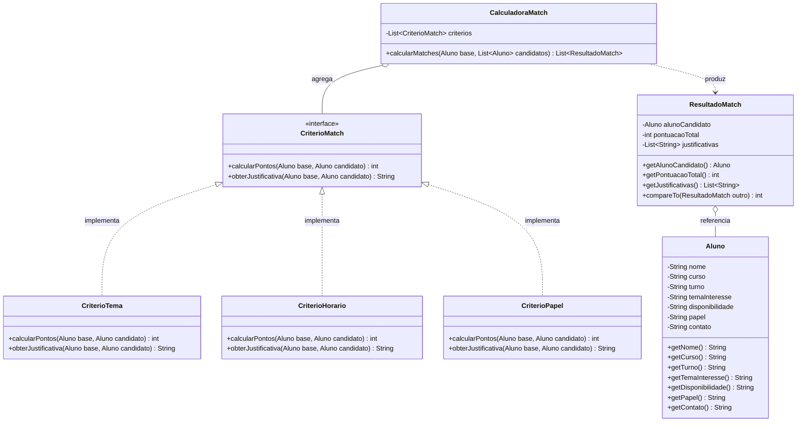

# Arquitetura e Backlog — Match TCC

Este documento apresenta a modelagem orientada a objetos da solução e a organização do backlog de desenvolvimento da equipe.

---

## 1. Modelagem Orientada a Objetos e Diagrama de Classes

A estrutura do sistema foi projetada aplicando conceitos de orientação a objetos avançada: encapsulamento, polimorfismo via interfaces e desacoplamento de responsabilidades.

### Relação com Conceitos de POOA

* **Padrão Strategy (GoF):** A interface `CriterioMatch` define o contrato comum para as estratégias de pontuação. Cada critério (`CriterioTema`, `CriterioHorario`, `CriterioPapel`) encapsula seu algoritmo de avaliação e sua respectiva justificativa textual de forma isolada.
* **Princípio da Responsabilidade Única (SRP):** Cada classe de critério avalia unicamente sua dimensão de dados, enquanto a `CalculadoraMatch` atua apenas na coordenação da execução e totalização dos scores.
* **Princípio Aberto/Fechado (OCP):** A inclusão de novas regras de compatibilidade ocorre pela criação de novas classes implementando `CriterioMatch`, sem necessidade de modificação no código da `CalculadoraMatch`.
* **Polimorfismo e Ordenação:** A classe `ResultadoMatch` implementa `Comparable<ResultadoMatch>`, permitindo que a ordenação decrescente por score ocorra nativamente via `Collections.sort()`.

---

## 2. Backlog e Divisão de Tarefas

Conforme o item 3 do Contrato Mínimo da Equipe (página 3 do manual do POOALAB), o desenvolvimento está organizado nas seguintes entregas. A fundação conceitual e o esqueleto inicial foram consolidados, e as frentes da Etapa 3 em diante estão em processo de distribuição entre os membros da equipe:

| Item | Descrição da Tarefa | Prioridade | Responsável | Estado |
| :---: | :--- | :---: | :--- | :---: |
| **01** | Estruturação da documentação inicial (Anexos A, B, C e E) e repositório | Alta | Ryan David | Concluído |
| **02** | Modelagem das classes de domínio (`model`), regras (`strategy`) e motor inicial | Alta | Ryan David | Concluído |
| **03** | Interface interativa no terminal (captura de dados via teclado e exibição de menus) | Alta | Pablo Franca | A Fazer |
| **04** | Implementação da suite de testes automatizados com JUnit 5 | Média | A definir (Alinhamento da equipe) | A Fazer |
| **05** | Preparação da base de alunos para teste e roteiro da demonstração (`demo/`) | Média | A definir (Alinhamento da equipe) | A Fazer |
| **06** | Elaboração dos slides do Pitch em PDF (roteiro oficial de 5 minutos) | Média | Luis henrique | A Fazer |
| **07** | Gravação do vídeo de contingência e teste de execução em ambiente limpo | Baixa | A definir (Alinhamento da equipe) | A Fazer |
